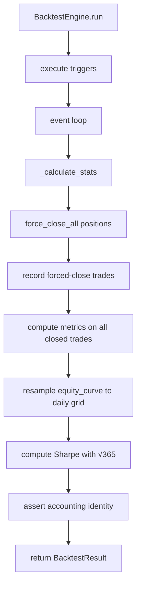

# PRP: Backtest Engine MTM 修復（強制平倉 + Sharpe 年化 + Funding 入帳）

## 1. Problem Statement

**核心問題**：`backtest/engine.py` 的 `_calculate_stats` 只統計「已平倉」交易，導致：
- 回測結束時仍開著的部位，其浮盈浮虧完全不計入 PnL、交易數、PF、勝率
- MaxDD 走 equity curve（盯市），與 PnL 會計基礎不一致
- GA 系統性偏好「早實現盈利、晚不實現虧損」的 genome（高換手策略獲得會計優勢）
- 所有歷史 GA 分數、候選排名、通過率都是基於有缺陷的會計基礎

**次要問題**（Kimi 獨立發現，已驗證）：
- Sharpe 年化用 `√252`，但報酬序列是 per-trigger（間隔不規則），且 equity_curve 只在 trigger 時 append
- `total_funding_shadow` 累計但未扣 equity/balance，持倉越久低估越多

**影響範圍**：上一輪 100 代 GA（20260927T200000Z）的 1320 個評估、61 個候選、所有先前輪次。

## 2. Requirements

### Functional
- [ ] 回測結束時強制平倉所有未平倉部位（方案乙），使用 simulator 既有 fee/slippage 模型
- [ ] 強平交易計入 `total_trades`、`total_pnl`、`PF`、`win_rate`，標記 `exit_reason="end_of_backtest"`
- [ ] Sharpe 改為：equity curve 重取樣到固定日曆網格（日頻），年化因子 `√365`
- [ ] Funding 費用扣入 equity/balance，或明文排除並在報告揭露（二選一、全管線一致）
- [ ] 會計恆等式斷言：`final_equity - initial_balance == Σ closed pnl`（±ε）

### Non-Functional
- [ ] 不改變任何 gate 門檻數值（Annual Gate 維持原樣）
- [ ] 所有 132 項回歸測試通過（必要時更新測試以符合新定義）
- [ ] 向後相容：歷史分數標記「engine v1 口徑，作廢」，新分數帶 engine 版本號
- [ ] 執行時間增加 < 5%（強平只在結束時跑一次）

## 3. Architecture

**關鍵函數修改**：
- `_calculate_stats()`：在計算指標前呼叫 `_force_close_all()`
- 新增 `_force_close_all(account, prices, config, end_time_ms)`：遍歷所有持倉，用收盤價平倉，扣 fee/slip
- 新增 `_resample_equity_daily(equity_curve, start_ms, end_ms)`：線性插值到固定日曆點
- 修改 Sharpe 計算區塊：用重取樣後的日頻報酬 × `√365`
- Funding：在 `_calculate_stats` 開頭扣入 `account.balance`（建議方案）

## 4. Acceptance Criteria

- [ ] BTC 買入持有基準：回測 365 天，盯市報酬 ≈ 獨立計算的 close-to-close 報酬（± fee/slip）
- [ ] BTC 買入持有：`total_trades == 1`（入場）+ 1（強平），`total_pnl_percent` 非零
- [ ] 任一回測：會計恆等式斷言通過
- [ ] 12 候選重跑：Y2 盯市報酬 ≤ 20%（不再有 closed_pnl > 0 但 mtm < 20% 的幻覺）
- [ ] 132 項回歸測試全過
- [ ] Sharpe 年化：注入合成日頻 equity curve，回測 recovered Sharpe ≈ 理論值

## 5. Test Plan

### Unit Tests (新增/修改)
- [ ] `test_force_close_all_basic`：單一持倉強平，PnL 正確扣 fee/slip
- [ ] `test_force_close_all_multiple`：多幣種持倉同時強平
- [ ] `test_force_close_all_no_position`：無持倉時不報錯
- [ ] `test_force_close_all_missing_price`：缺價 fallback + flag，不靜默跳過
- [ ] `test_resample_equity_daily`：已知 equity curve 重取樣到日頻，報酬正確
- [ ] `test_sharpe_annualization`：合成 μ=0.001、σ=0.01 日頻曲線，recovered Sharpe ≈ μ/σ*√365
- [ ] `test_accounting_identity`：隨機 genome 跑完，斷言恆等式成立
- [ ] `test_funding_in_equity`：持倉 30 天，funding 正確扣入 balance

### Integration Tests
- [ ] `test_btc_buy_and_hold_benchmark`：BTC 買入持有 365 天，指標與獨立計算一致
- [ ] `test_full_backtest_metrics_consistency`：完整回測，所有指標口徑一致（PF/勝率/交易數都基於同一組 closed trades）

### Regression Tests
- [ ] 現有 132 項全跑（必要時更新 expected values）

## 6. Risks & Mitigations

| Risk | Likelihood | Impact | Mitigation |
|------|------------|--------|------------|
| 強平邏輯與既有平倉程式碼不一致（雙重扣費/漏扣） | 中 | 高 | 必須走 simulator 既有的平倉路徑（同一函數），不可手算 |
| equity_curve 時間軸對齊錯誤（最後一點不在 end_time） | 高 | 中 | 顯式取「≤ end_time 的最後一根已收盤 1h K」價格 |
| 多幣種缺價導致 equity 需空少一塊 | 中 | 高 | fallback 到最後可得價並打 flag，不可靜默跳過 |
| 強平把 genome 推過 730/年上限 | 低 | 低 | 選定「強平計入 total_trades（誠實），靠 exit_reason 可篩」，寫進文件 |
| Sharpe 重取樣引入插值偏差 | 低 | 低 | 用線性插值，日頻網格固定；端點敏感度測試（±1 bar）量化 |
| 修復後通過率大幅下降，誘導調低門檻 | 高 | 高 | **門檻一字不動**，歷史分數標記作廢，這是正確方向 |

## 7. Rollback Plan
- Feature flag: 引擎版本號 `engine_version` 在 BacktestResult 中帶回
- 如需回滾：`ENGINE_VERSION=v1` 環境變數切回舊口徑（保留舊 _calculate_stats 作為 fallback）
- 或直接 `git revert` 修復 commit

## 8. Sign-offs
- Planner (User): 
- Architect (Claude): 
- Reviewer (Codex): 

---

**PRP 狀態**：等待 Planner 簽核（批准後進入 Code 階段）